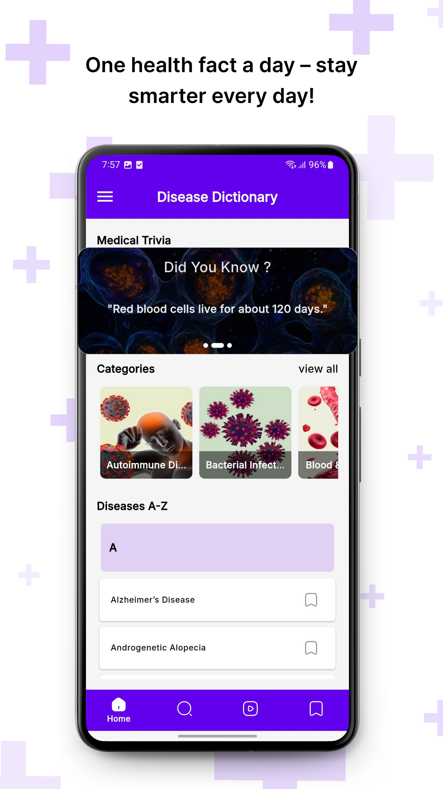
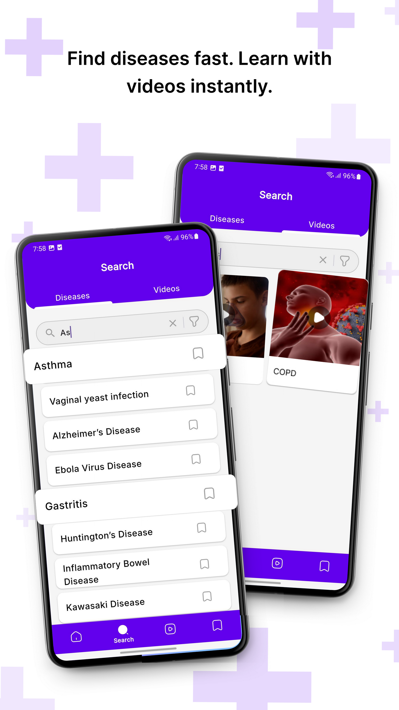
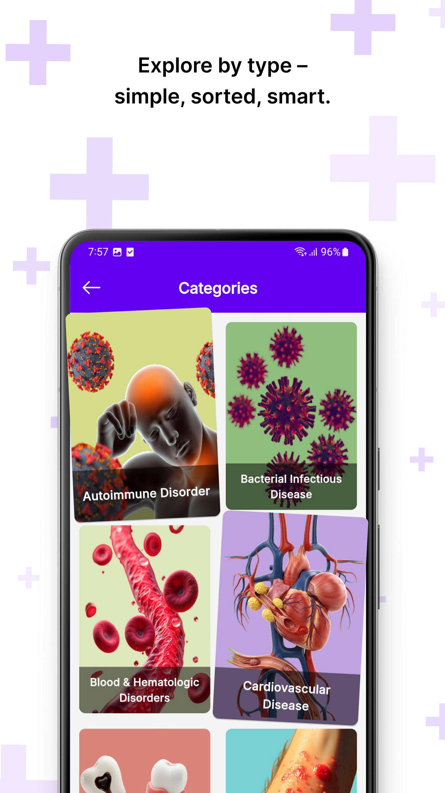
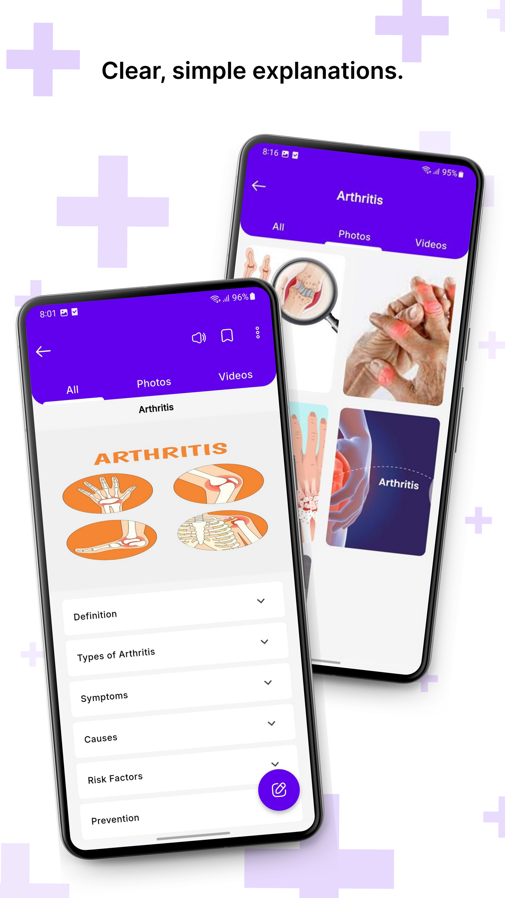
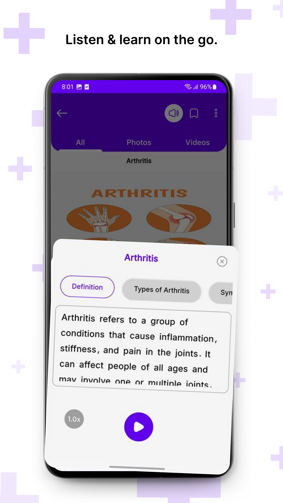
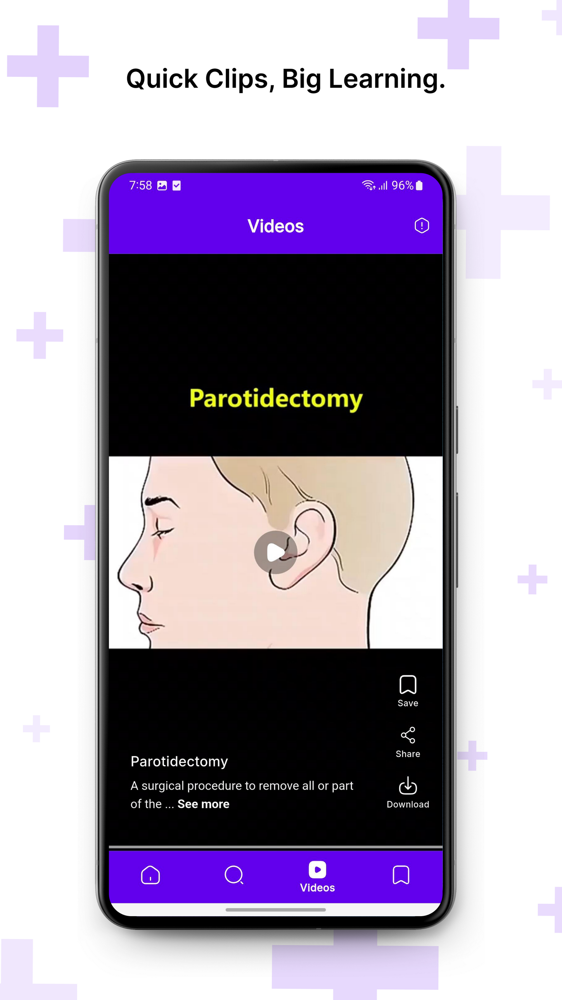
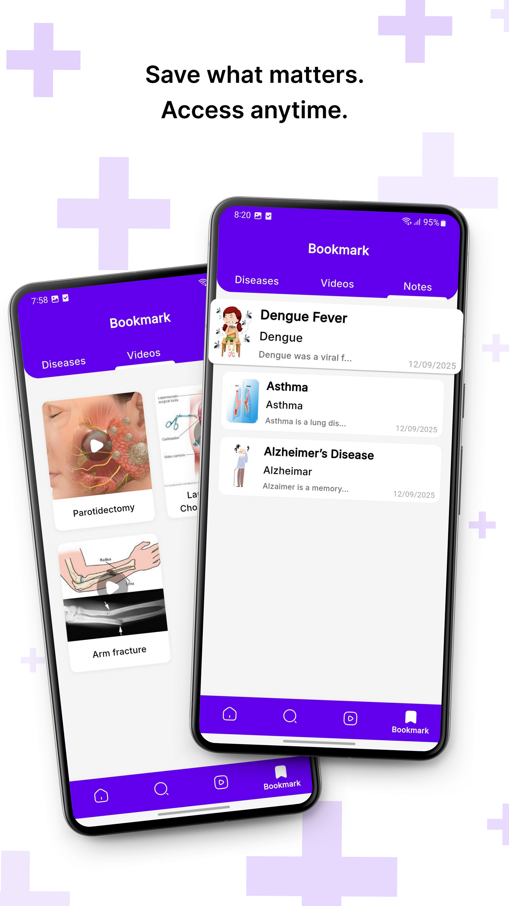

# 📱 Disease Dictionary — Flutter Mobile Application Case Study

<p align="center">
  
  
  
  
  
</p>

---

## 📌 Project Overview

**Disease Dictionary** is a production-grade Flutter mobile application designed to empower users, students, and healthcare enthusiasts to explore disease-related medical information through searchable reference content, interactive educational video reels, and personalized study records.

The application bridges complex medical reference materials into an intuitive, accessible mobile interface featuring:
- **Instant Search & Deep Filtering** across medical categories.
- **Vertical "Reels-style" Educational Videos** with smooth gesture-driven playback.
- **Accessibility-oriented Text-to-Speech (TTS)** with real-time audio playback controls.
- **Personalized Bookmarks & Local Study Notes** for quick offline review.

---

## 📱 Application Screenshots & User Interface

<div align="center">
  <table>
    <tr>
      <td width="33%" align="center">
        
        <br /><b>Daily Health Trivia & Categories</b>
      </td>
      <td width="33%" align="center">
        
        <br /><b>Dual-Tab Search & Videos</b>
      </td>
      <td width="33%" align="center">
        
        <br /><b>3D Visual Medical Categories</b>
      </td>
    </tr>
    <tr>
      <td width="33%" align="center">
        
        <br /><b>Disease Details & TTS Trigger</b>
      </td>
      <td width="33%" align="center">
        
        <br /><b>Interactive TTS Audio Player</b>
      </td>
      <td width="33%" align="center">
        
        <br /><b>Medical Video Reels Player</b>
      </td>
    </tr>
  </table>
  
  <p align="center">
    
    <br /><b>Bookmarks & Personal Study Notes Management</b>
  </p>
</div>

---

## 👨‍💻 My Role & Engineering Responsibilities

**Flutter Developer — End-to-End Application Engineering**

As the primary mobile engineer on this product, I architected and implemented the core mobile application features from UI layout to asynchronous data binding:

### 1. Disease Categories & Content Discovery
- Built responsive, topic-based category browsing matching healthcare ontology.
- Engineered instant search with debounced input and multi-criteria filters to ensure smooth 60 FPS scrolling through thousands of disease entries.

### 2. Educational Video Reels Experience
- Engineered a vertically scrolling, reels-style video player optimized for short-form medical learning.
- Implemented smooth video playback controllers, buffer state indicators, and tap-to-pause interactions.

### 3. Integrated Text-to-Speech (TTS)
- Integrated native Text-to-Speech audio engine to read medical entries aloud for accessibility.
- Engineered interactive audio sheet controls including speed modifiers (0.5x, 1.0x, 1.5x, 2.0x), play/pause toggles, and sentence tracking.

### 4. Bookmarking & Study Notes Persistence
- Implemented one-tap bookmarking for diseases and educational videos.
- Integrated structured local storage allowing users to attach custom study notes directly to saved medical terms.

---

## 🛠️ Technical Focus & Architecture

```
┌────────────────────────────────────────────────────────┐
│                   Flutter Presentation                  │
│  (Custom Widgets, Material 3, Dark Aesthetics, Reels)   │
└───────────────────────────┬────────────────────────────┘
                            │
┌───────────────────────────▼────────────────────────────┐
│                 StreamBuilder State Layer              │
│    (Reactive UI Streaming, Non-blocking Asynchronous)  │
└─────────────┬───────────────────────────┬──────────────┘
              │                           │
┌─────────────▼──────────────┐ ┌──────────▼──────────────┐
│       REST API Pipeline    │ │      Local Services     │
│   (Dio/http, JSON models,  │ │  (Flutter TTS Engine,   │
│    error fallback handling)│ │   SQLite / Bookmarks)   │
└────────────────────────────┘ └─────────────────────────┘
```

- **Framework**: Flutter (v3.x) & Dart
- **State Management**: `StreamBuilder` reactive stream architecture for real-time UI updates
- **Networking**: REST API integration with structured JSON model deserialization
- **Audio / Voice**: Text-to-Speech (TTS) service with dynamic speech rate controllers
- **Video Playback**: Vertical PageView controller integrated with hardware-accelerated video codecs
- **Data Persistence**: Local bookmark caching and personal notes storage

---

## 💡 Key Takeaways & Engineering Outcomes

- **Multimedia in Flutter**: Hands-on mastery in combining video playback controllers with background audio and reactive UI without frame drops.
- **Accessibility by Design**: Making dense reference content consumable through visual, audio (TTS), and video channels.
- **Production Delivery**: Successfully published and optimized for the Google Play Store environment.

---

## 🔒 Project Privacy Notice

This repository serves as a **public technical case study and architecture overview** of my professional development work. Proprietary application source code, production API keys, private backend endpoints, credentials, and customer data are intentionally excluded to protect intellectual property and confidentiality agreements.

---

## 📬 Contact & Portfolio

**Kabilan R** — Flutter & Mobile Application Developer  
- **🌐 Portfolio**: [https://kabilan-portfolio.vercel.app](https://kabilan-portfolio.vercel.app)  
- **🐙 GitHub**: [@Kabilan0624](https://github.com/Kabilan0624)  
- **💼 LinkedIn**: [linkedin.com/in/kabilan-r](https://linkedin.com/in/kabilan-r)  
- **📧 Email**: [kabilanr244@gmail.com](mailto:kabilanr244@gmail.com)
